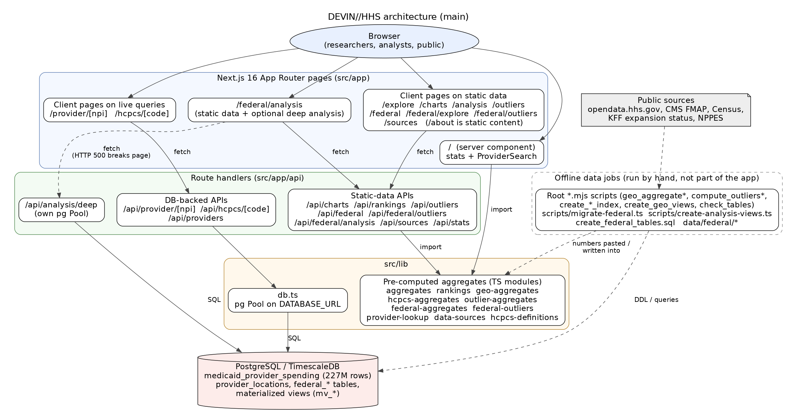

# DEVIN//HHS

Full transparency into Medicaid provider spending across the United States.

**Live:** https://devin-hhs.vercel.app

## Overview

DEVIN//HHS provides unprecedented transparency into Medicaid provider spending, transforming 227 million healthcare spending records into accessible, searchable information for researchers, policymakers, and the public.

## Features

### Provider Analysis
- **227M+ Records** - Complete Medicaid provider utilization data (2018-2024)
- **Provider Search** - Look up any provider by NPI
- **HCPCS Analysis** - Procedure code breakdowns with spending trends
- **Outlier Detection** - Statistical identification of unusual spending patterns

### Federal Funding
- **FMAP Rates** - Federal Medical Assistance Percentage for the 50 states and DC (FY2022-2024)
- **Expansion Analysis** - Comparison of expansion vs non-expansion states
- **Congressional Districts** - Estimates for 436 districts, made by splitting each state's spending evenly across its House seats; the Districts tab lists the top 25 and `/api/federal` returns all 436 (`allDistricts`)
- **Analysis pages** - Policy narrative generated from the pre-computed figures (no model is called at runtime)

### Visualizations
- Interactive charts powered by Recharts
- Geographic distribution analysis
- Time series trends
- Cost efficiency metrics

## Architecture

See [docs/architecture.md](docs/architecture.md) for how pages, API routes, pre-computed data and the database fit together.



The diagram is generated from [docs/diagrams/architecture.dot](docs/diagrams/architecture.dot); run `docs/diagrams/render.sh` (needs Graphviz) after editing it. An [SVG](docs/diagrams/architecture.svg) is also committed.

## Tech Stack

- **Framework:** Next.js 16 (App Router), React 19, TypeScript
- **Styling and charts:** Tailwind CSS 4, Recharts
- **Database:** PostgreSQL (TimescaleDB) via `pg`, used only by the provider, HCPCS and deep-analysis routes; everything else is served from pre-computed data in `src/lib/`
- **Tests:** Vitest (unit), Playwright (end to end)
- **Deployment:** Vercel
- **Data sources:** see [Data Sources](#data-sources)

## Development

Requires Node.js 20 or newer (CI uses Node 20).

```bash
# Install dependencies
npm ci

# Run development server (http://localhost:3000)
npm run dev

# Lint
npm run lint

# Unit tests (Vitest)
npm test

# End-to-end tests (Playwright). Defaults to the live site; point it at a local server with BASE_URL.
npx playwright install chromium
BASE_URL=http://localhost:3000 npm run test:e2e

# Build for production
npm run build
```

## Environment Configuration

The only variable the code reads is `DATABASE_URL` (a PostgreSQL connection string; TLS is always on). It is kept in the Vercel project:

```bash
# Connect to Vercel project
vercel link

# Pull environment variables for local development
vercel env pull .env.local
```

Without it, the pre-computed pages still work, but `/provider/[npi]`, `/hcpcs/[code]`, `/api/providers` and `/federal/analysis` do not. The scripts in `scripts/` and most root `*.mjs` files also read `.env.local`; they build the database tables, views and aggregates and are run by hand.

**No credentials are stored in this repository.**

## Project Structure

```
src/
├── app/
│   ├── page.tsx           # Home: headline stats, top providers, NPI search
│   ├── explore/           # Provider rankings
│   ├── charts/            # Charts
│   ├── analysis/          # Narrative analysis
│   ├── outliers/          # Statistical outliers
│   ├── federal/           # FMAP, expansion and district pages (+ explore, outliers, analysis)
│   ├── provider/[npi]/    # Provider detail (database)
│   ├── hcpcs/[code]/      # Procedure-code detail (database)
│   ├── sources/           # Data source list
│   ├── about/
│   └── api/               # Route handlers for the pages above
├── lib/
│   ├── db.ts                    # PostgreSQL pool and queries
│   ├── aggregates.ts            # Pre-computed totals and top providers
│   ├── rankings.ts              # Provider rankings
│   ├── geo-aggregates.ts        # State and city spending
│   ├── hcpcs-aggregates.ts      # Procedure-code totals
│   ├── hcpcs-definitions.ts     # Procedure-code names and categories
│   ├── outlier-aggregates.ts    # Outlier lists (+ .json)
│   ├── zscore-analogies.ts      # Plain-language z-score analogies
│   ├── federal-aggregates.ts    # FMAP, expansion and district data
│   ├── federal-outliers.ts      # Per-capita outliers
│   ├── provider-lookup.ts       # Provider names (NPPES)
│   ├── data-sources.ts          # Source catalogue
│   └── *.test.ts                # Vitest unit tests
└── components/
    ├── ProviderSearch.tsx
    └── DataVerificationBadge.tsx
scripts/                   # Database migrations and materialized views (run by hand)
*.mjs, *.sql               # One-off aggregation and indexing scripts (run by hand)
data/federal/              # Raw FMAP, district crosswalk and population files
e2e/                       # Playwright tests
docs/                      # Architecture doc and diagram
```

## Data Sources

- **Provider Spending:** HHS Open Data - Medicaid Provider Utilization
- **FMAP Rates:** CMS Federal Medical Assistance Percentage (FY2022-2024)
- **Congressional Districts and Population:** Census Bureau
- **Medicaid Expansion Status:** KFF
- **Provider Registry:** NPPES (National Plan and Provider Enumeration System)

## Built With

This transparency platform was built using **Devin CLI** — demonstrating AI-assisted development for complex, data-intensive applications.

## License

This project provides transparency into public data. The underlying data is from [opendata.hhs.gov](https://opendata.hhs.gov) and is in the public domain.
