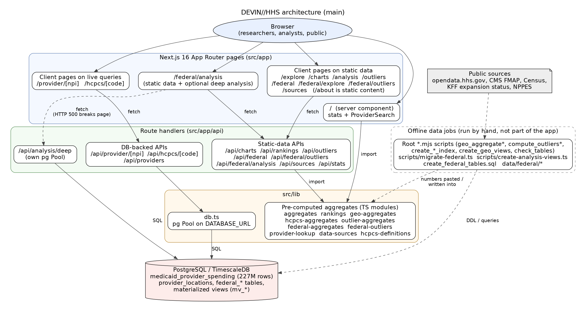

# Architecture

This page describes the DEVIN//HHS code on `main`: a Next.js app that serves Medicaid provider-spending and federal-funding views, mostly from pre-computed data, with a few routes that query PostgreSQL live.

The diagram source is [`diagrams/architecture.dot`](diagrams/architecture.dot) (Graphviz). After editing it, run `docs/diagrams/render.sh` to regenerate `architecture.png` and `architecture.svg` (needs `graphviz`).

## Runtime

- **Framework:** Next.js 16 (App Router, Turbopack build), React 19, TypeScript 5.
- **Styling:** Tailwind CSS 4 via `@tailwindcss/postcss`. `@uswds/uswds` is a dependency but is not imported by any source file.
- **Charts:** Recharts 3.
- **Database client:** `pg` (node-postgres), connecting with `DATABASE_URL` and TLS (`rejectUnauthorized: false`).
- **Hosting:** Vercel (the live site is https://devin-hhs.vercel.app). There is no `vercel.json`; the project uses Vercel defaults.

## Two data paths

Most of the app never touches the database. The 227M-row dataset was aggregated offline and the results were committed as TypeScript modules in `src/lib/`.

| Path | Data | Routes |
|------|------|--------|
| Pre-computed | TS modules in `src/lib/` imported at build/request time | `/`, `/explore`, `/charts`, `/analysis`, `/outliers`, `/federal`, `/federal/explore`, `/federal/outliers`, `/sources`, `/about` and their APIs |
| Live SQL | `medicaid_provider_spending` and federal tables/views in PostgreSQL | `/provider/[npi]`, `/hcpcs/[code]`, `/api/providers`, and the optional deep analysis on `/federal/analysis` |

Without a reachable `DATABASE_URL`, the pre-computed pages work and the live-SQL APIs return HTTP 500. One exception: `/federal/analysis` treats the 500 body from `/api/analysis/deep` as data, so the page fails to render without the database.

## Pages (`src/app`)

All pages except `/` and `/about` are client components that `fetch` an API route on mount.

| Page | Fetches | Notes |
|------|---------|-------|
| `/` | (imports `aggregates.ts` directly) | Server component; headline stats, top providers, NPI search box (`ProviderSearch`) that navigates to `/provider/[npi]` |
| `/explore` | `/api/rankings?sort=&page=&limit=` | Top 1,250 providers by paid, claims or beneficiaries, 50 per page |
| `/charts` | `/api/charts` | Time, HCPCS, geographic and provider charts |
| `/analysis` | `/api/charts` | Narrative "AI analysis" text built in the page from the chart data (no model is called at runtime) |
| `/outliers` | `/api/outliers` | Provider, HCPCS, cost-per-claim and repeat-procedure z-score outliers |
| `/federal` | `/api/federal` | FMAP rates, expansion comparison, per-jurisdiction and congressional-district tabs; links to the three pages below |
| `/federal/explore` | `/api/federal`, `/api/federal/outliers` | Sortable state table with source links |
| `/federal/outliers` | `/api/federal/outliers` | Per-capita outliers using Census population |
| `/federal/analysis` | `/api/federal/analysis`, `/api/analysis/deep` | Deep-analysis section is meant to show only when the DB call succeeds (see the note under Two data paths) |
| `/sources` | `/api/sources` | Data source list from `data-sources.ts` |
| `/about` | none | Static content |
| `/provider/[npi]` | `/api/provider/[npi]` | Live SQL |
| `/hcpcs/[code]` | `/api/hcpcs/[code]` | Live SQL |

`src/components/` holds `ProviderSearch` and `DataVerificationBadge` (record count and source badge shown on federal pages).

## API routes (`src/app/api`)

| Route | Source | Caching |
|-------|--------|---------|
| `charts` | `aggregates`, `geo-aggregates`, `hcpcs-aggregates`, `hcpcs-definitions`, `provider-lookup` | dynamic |
| `rankings` | `rankings.ts` | dynamic |
| `stats` | `getStats()` in `db.ts`, which returns hard-coded totals (no query) | dynamic |
| `outliers` | `outlier-aggregates.ts` | static, revalidate 24 h |
| `federal`, `federal/analysis` | `federal-aggregates.ts` | static, revalidate 24 h |
| `federal/outliers` | `federal-outliers.ts` | static, revalidate 24 h |
| `sources` | `data-sources.ts` | static, revalidate 24 h |
| `providers` | `getProviders()` → `medicaid_provider_spending` | dynamic |
| `provider/[npi]` | `getProviderByNPI()`, `getMonthlySpendingByNPI()` | dynamic |
| `hcpcs/[code]` | `getHcpcsAnalysis()`, `getMonthlySpendingByHCPCS()` | dynamic |
| `analysis/deep` | its own `pg` Pool; `mv_key_insights`, `mv_fmap_quartile_summary`, `mv_fmap_efficiency_analysis`, `federal_fmap`, `federal_state_spending` | dynamic |

## Pre-computed data (`src/lib`)

- `aggregates.ts`: yearly and monthly totals (2018-2024), top providers, total spending/claims/rows.
- `rankings.ts`: the top-1,250 provider rankings behind `/explore`.
- `geo-aggregates.ts`: spending by state and city, per-capita figures.
- `hcpcs-aggregates.ts`, `hcpcs-definitions.ts`: procedure-code totals, names and categories.
- `outlier-aggregates.ts` (+ `outlier-aggregates.json`), `zscore-analogies.ts`: outlier lists and plain-language probability analogies.
- `federal-aggregates.ts`: FMAP FY2022-2024 for the 50 states and DC, expansion status, and district spending. District figures are generated by splitting each state's spending evenly across its House seats (`CD_COUNT`, 436 in total), not measured per district. `/api/federal` returns the top 25 as `topDistricts` (what `/federal` shows) and all 436 as `allDistricts`.
- `federal-outliers.ts`: per-capita outliers from state spending and Census 2020 population.
- `provider-lookup.ts`: names and specialties for the top NPIs (from NPPES).
- `data-sources.ts`: the source catalogue shown on `/sources`.

## Offline data jobs

These run by hand against the database with `DATABASE_URL` in `.env.local` (`dotenv`); none run in the app, the build or CI.

- `scripts/migrate-federal.ts`: creates and fills `federal_fmap`, `federal_state_spending`, `data_sources`.
- `scripts/create-analysis-views.ts`: creates `mv_provider_*`, `mv_hcpcs_*`, `mv_state_*`, `mv_fmap_moral_hazard`, `mv_monthly_trends`, `mv_analysis_summary` and indexes.
- Root scripts: `geo_aggregate*.mjs`, `create_geo_views.mjs` (state/city aggregates, written to `/tmp/*.json`), `compute_outliers.mjs` (to `/tmp`), `compute_outliers_local.mjs` (reads the TS aggregates, writes `src/lib/outlier-aggregates.json`, no DB), `create_index_simple.mjs`, `create_npi_index.mjs`, `check_tables.mjs`, `create_federal_tables.sql`.
- `data/federal/`: raw FMAP, ZIP/ZCTA-to-district crosswalk and population files, plus `build_cd_mapping.py`. No app code reads them.

Results from these jobs reach the app by being copied into the `src/lib` modules and committed.

## Tests and CI

- `npm test`: Vitest (jsdom) over `src/**/*.test.ts`: `federal-aggregates`, `federal-outliers`, `hcpcs-definitions`.
- `npm run test:e2e`: Playwright (`e2e/app.spec.ts`, Chromium). `baseURL` defaults to the production site; set `BASE_URL=http://localhost:3000` to test a local server.
- `.github/workflows/ci.yml` on pushes and PRs to `main`: `npm ci`, lint (`|| true`), `npm test`, `npm run build`; then an e2e job (`|| true`). Neither lint nor e2e failures fail the workflow, and the e2e job sets no `BASE_URL`, so it runs against production.

## Configuration

`DATABASE_URL` is the only environment variable the code reads. It is kept in the Vercel project; `vercel env pull .env.local` fetches it for local use. No credentials are committed.
